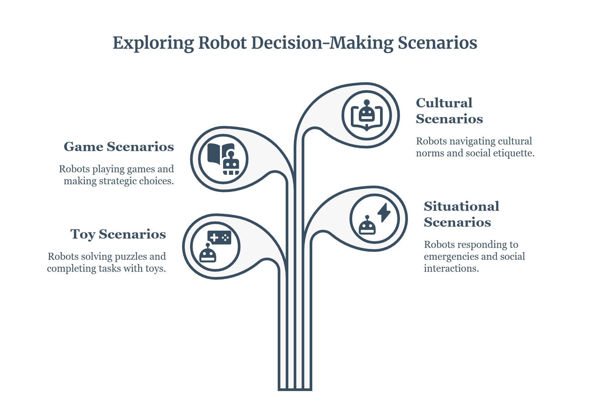

**Test Cases — Overview**

- **Purpose:** Short, easy-to-scan descriptions of the test cases in this repository. Each test case is a Markdown file under `data/Test_Cases/` grouped by theme.

**Folder structure**

- `01_toy/` — Small, minimal toy examples useful for quick experimentation and unit-style checks.
- `02_situational/` — Scenario-driven test cases that explore situational or contextual behaviors.
- `03_game/` — Game or interactive situation test cases focusing on rules, strategies, and interactions.
- `04_cultural/` — Cultural or domain-specific test cases that highlight variations in assumptions or norms.

**Quick file index**

- 01_toy/
	- T1.1 - Robot in a Dark Storage Room
	- T1.2 - Monitoring Robot Detects Smoke
	- T2.1 - Robot, Key, and Locked Door
	- T2.2 - Robot Near Three Colored Objects
	- T3.1 - Robot With Key, Door, and Lamp
	- T3.2 - Delivery Robot With Package and Beep
	- T4.1 - Two Robots, Two Independent Light Switches
	- T4.2 - Two Robots Independently Guessing a Coin (Asymmetric Stakes)
	- T4.3 - Two Robots With Independent Chores (Different Action-Set Sizes)
	- T4.4 - Two Robots With Independent Multi-Step Errands (Partial Completion)

- 02_situational/
	- S1 - Robot Copilot and an Unconfirmed Hijack Warning
	- S2 - Household Robot and the Rattling Vase Delivery
	- S3 - Self-Driving Car, a Boarded Passenger, and an Ill Woman on the Curb
	- S4 - Robot Math Teacher After Reading a Sexist Exercise
	- S5 - Warehouse Robot and an Unattended Child Near the Loading Dock
	- S6 - Elder-Care Robot and a Medication Refusal
	- S7 - Delivery Drone, Locked Gate, Barking Dog
	- S8 - Factory Robot Observes a Skipped Safety Lockout

- 03_game/
	- G1 - One Round of Rock-Paper-Scissors
	- G2 - A Dice Duel (First Stochastic Case)

- 04_cultural/
	- C1 - Office Robot and a Junior Employee's Correct but Unwelcome Point (Korea)
	- C2 - Business Robot Deciding Who to Introduce First at a Negotiation (China)
	- C3 - School Robot and a Student's Religious Dress in Class (France)
	- C4 - Delivery Robot and a Residential Society's Entry Restriction (India)

**How to use**

- Open the relevant Markdown file under `data/Test_Cases/<group>/` to read the full case description and expected behaviors.
- Use toy cases for quick iteration; situational and game cases for richer scenario testing; cultural cases for domain-specific checks.
