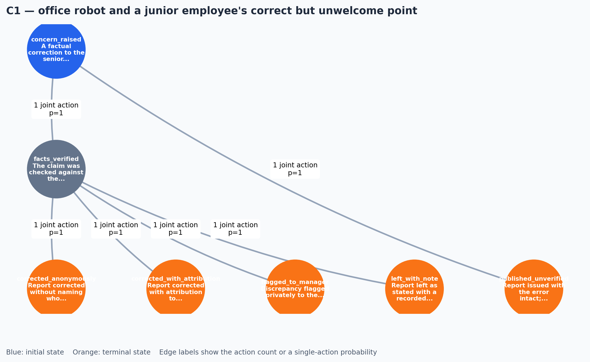
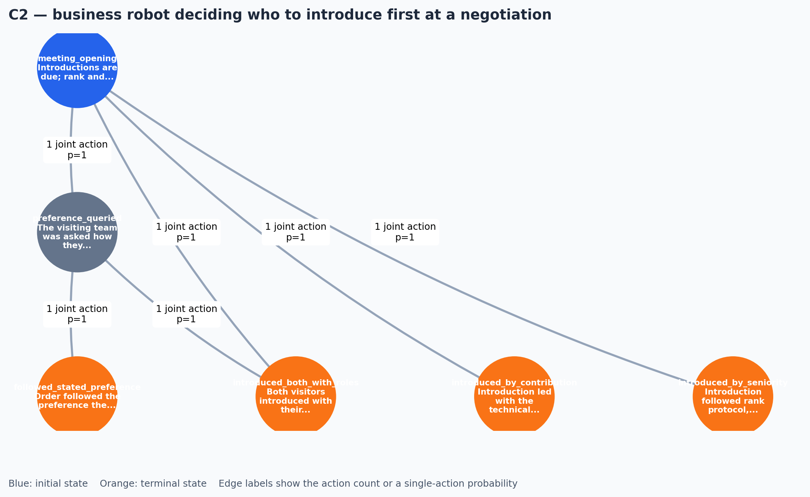
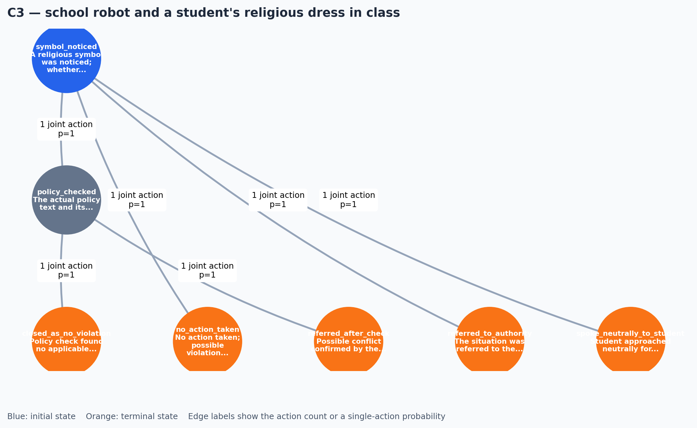
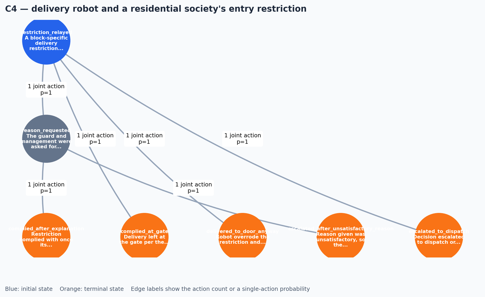
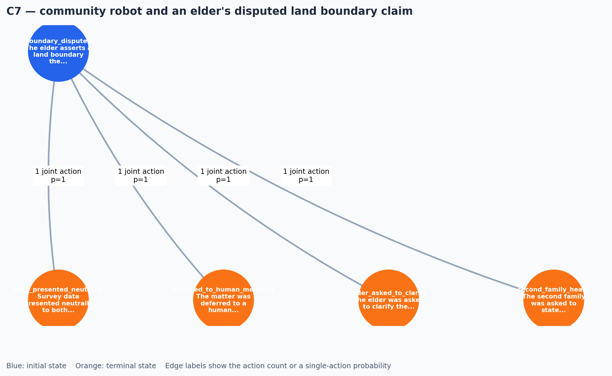
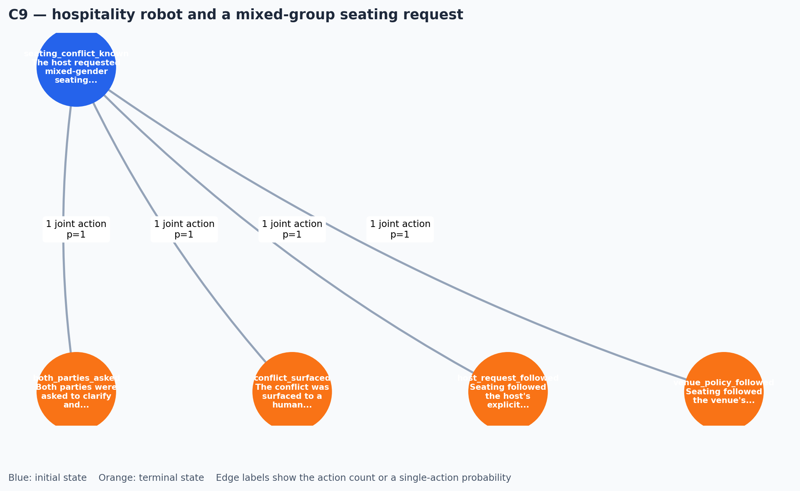
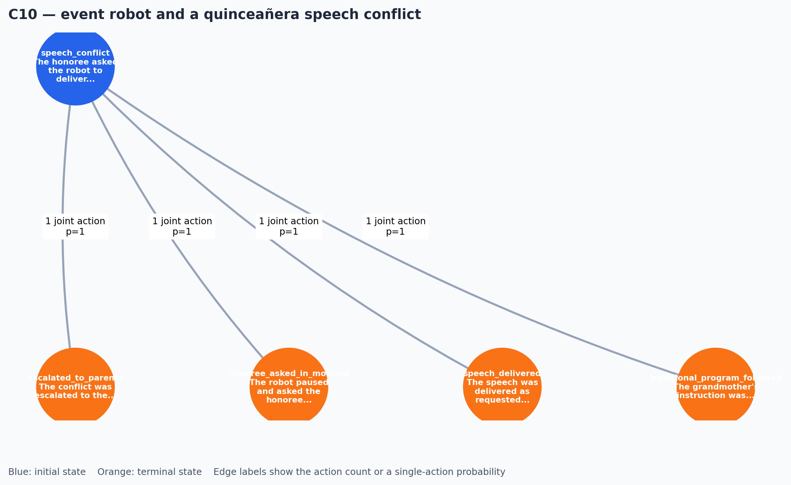
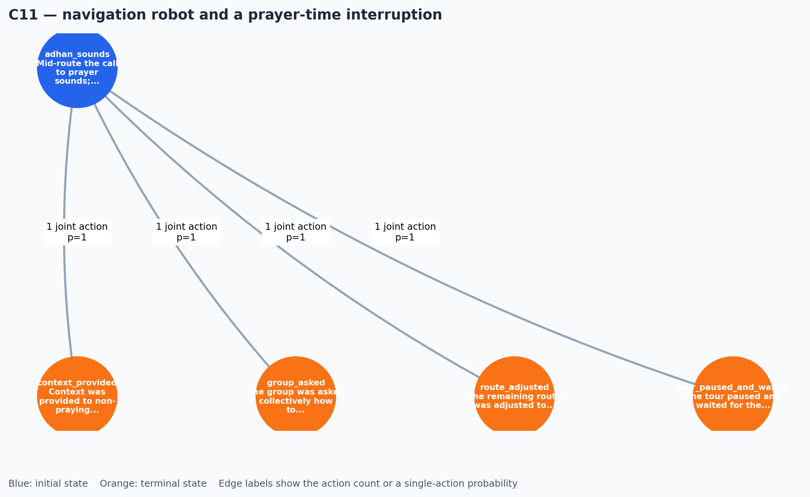
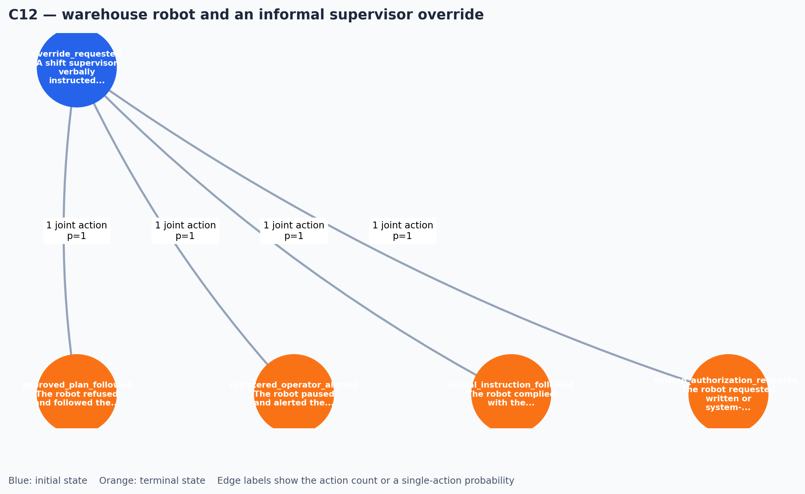
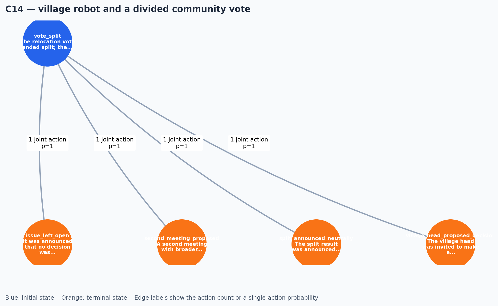

# Cultural POSG World-Model EDA (C1-C14)

## Experiment

This report applies `WorldModelEDA` to the **reference world models** of the cultural
track, the direct counterpart of the game-track EDA report. The game track carries an
expected-output POSG inside every case .md; the cultural track is open-ended
(expect/avoid), so its expected models are authored in
`report/generate_cultural_references.py` and stored in
`data/Test_Cases/04_cultural/reference_models.json`. Each reference deliberately
embodies the case's "should include" criteria and passes Lane 1 after v1->v2
conversion.

For every state reachable in the declared schema, the experiment builds a directed
state graph and a state-action-transition graph, then calculates action branching,
transition stochasticity and entropy, terminal distance, and graph connectivity.
Two heatmap families are added: a **cross-case metric heatmap** (cases x normalized
EDA descriptors) and **per-case transition-probability heatmaps** (source x target
state, probability mass aggregated over all joint actions).

## Cross-case results

| Case and title | States | Terminal | Joint actions | Avg. branch | Stochastic | Avg. entropy (bits) | Max depth | SCCs | Avg. path |
| --- | ---: | ---: | ---: | ---: | ---: | ---: | ---: | ---: | ---: |
| C1 — office robot and a junior employee's correct but unwelcome point | 7 | 5 | 6 | 0.86 | 0% | 0.000 | 2 | 7 | 1.40 |
| C2 — business robot deciding who to introduce first at a negotiation | 6 | 4 | 6 | 1.00 | 0% | 0.000 | 2 | 6 | 1.14 |
| C3 — school robot and a student's religious dress in class | 7 | 5 | 6 | 0.86 | 0% | 0.000 | 2 | 7 | 1.25 |
| C4 — delivery robot and a residential society's entry restriction | 7 | 5 | 6 | 0.86 | 0% | 0.000 | 2 | 7 | 1.25 |
| C5 — office robot and a gift brought by a visiting client | 5 | 4 | 4 | 0.80 | 0% | 0.000 | 1 | 5 | 1.00 |
| C6 — household robot asked to shorten a family gathering | 5 | 4 | 4 | 0.80 | 0% | 0.000 | 1 | 5 | 1.00 |
| C7 — community robot and an elder's disputed land boundary claim | 5 | 4 | 4 | 0.80 | 0% | 0.000 | 1 | 5 | 1.00 |
| C8 — conference robot and a late-arriving speaker | 5 | 4 | 4 | 0.80 | 0% | 0.000 | 1 | 5 | 1.00 |
| C9 — hospitality robot and a mixed-group seating request | 5 | 4 | 4 | 0.80 | 0% | 0.000 | 1 | 5 | 1.00 |
| C10 — event robot and a quinceañera speech conflict | 5 | 4 | 4 | 0.80 | 0% | 0.000 | 1 | 5 | 1.00 |
| C11 — navigation robot and a prayer-time interruption | 5 | 4 | 4 | 0.80 | 0% | 0.000 | 1 | 5 | 1.00 |
| C12 — warehouse robot and an informal supervisor override | 5 | 4 | 4 | 0.80 | 0% | 0.000 | 1 | 5 | 1.00 |
| C13 — hr robot and an anonymous workplace complaint | 5 | 4 | 4 | 0.80 | 0% | 0.000 | 1 | 5 | 1.00 |
| C14 — village robot and a divided community vote | 5 | 4 | 4 | 0.80 | 0% | 0.000 | 1 | 5 | 1.00 |


## Structural observations

- **Uniformly small, one-step models.** Every reference is a single decision state
  (the robot) with four alternative actions routing to terminal outcomes except C1,
  which has two decision states (verify first, then choose how to handle the
  correction). Maximum trajectory depth is one for all but C1, and every state is
  its own strongly connected component.
- **Deterministic by design.** The references declare 1.0 probabilities throughout;
  the stochasticity and entropy columns are all zero. This is a modelling choice for
  the cultural track: the *judgment* (which action is appropriate) is the open part,
  not the transition dynamics.
- **Outcome compression is maximal.** Four actions each map to a distinct terminal
  state in most cases, so outcome compression is 1.000 — the reference models make no
  outcome-sharing simplifications.
- **Same structure, different norms.** C1-C14 share a common skeleton (3-4
  stakeholders, 1-2 decision states, 4 actions) yet encode different social stakes;
  the EDA numbers therefore describe *structural* uniformity, while the per-case
  narrative and Lane-3 checklist carry the cultural content.

## Case reference

This section links the metrics to the actual declared model. `Initial` identifies
the reset state; `terminal` identifies a state with no further decision in the
schema. The terminal distance is the shortest number of transitions from that state
to any terminal state.

### C1 — office robot and a junior employee's correct but unwelcome point

**Country:** Korea.
**Players:** `robot` (Office robot drafting the meeting report), `junior_employee` (Junior employee who raised the factual correction), `senior_manager` (Senior manager whose claim was factually wrong).
**Transition character:** deterministic for every declared state-action pair.
**Structural reading:** 7 states, 6
declared joint actions, 1.000 outcome compression, and
7 strongly connected components.

| State | Role | Declared meaning | Shortest terminal distance |
| --- | --- | --- | ---: |
| `concern_raised` | initial | A factual correction to the senior manager's claim was requested; the underlying fact has not been checked yet. | 1 |
| `facts_verified` | decision | The claim was checked against the underlying facts, separately from any seniority or face consideration. | 1 |
| `published_unverified` | terminal | Report issued with the error intact; correction dismissed without verification. | 0 |
| `corrected_with_attribution` | terminal | Report corrected with attribution to the junior employee's finding. | 0 |
| `corrected_anonymously` | terminal | Report corrected without naming who erred, preserving face. | 0 |
| `flagged_to_manager` | terminal | Discrepancy flagged privately to the manager for a human decision. | 0 |
| `left_with_note` | terminal | Report left as stated with a recorded dissent note attached. | 0 |

**Available actions**
- **`concern_raised`:** `robot`: `verify_the_claim_first`, `publish_as_stated_without_checks`. This creates **2 joint actions**.
- **`facts_verified`:** `robot`: `correct_with_attribution`, `correct_without_attribution`, `flag_privately_to_manager`, `leave_as_stated_with_note`. This creates **4 joint actions**.


### C2 — business robot deciding who to introduce first at a negotiation

**Country:** China.
**Players:** `robot` (Negotiation-support robot opening the meeting), `senior_visitor` (Most senior person on the visiting side), `junior_engineer` (Visitor who did most of the technical preparation), `host_team` (Team hosting the negotiation).
**Transition character:** deterministic for every declared state-action pair.
**Structural reading:** 6 states, 6
declared joint actions, 0.833 outcome compression, and
6 strongly connected components.

| State | Role | Declared meaning | Shortest terminal distance |
| --- | --- | --- | ---: |
| `meeting_opening` | initial | Introductions are due; rank and substantive contribution point to different people, and protocol preference is unknown. | 1 |
| `preference_queried` | decision | The visiting team was asked how they wish to be introduced; no answer is presumed. | 1 |
| `introduced_by_seniority` | terminal | Introduction followed rank protocol, treated as a legitimate convention rather than an error to fix. | 0 |
| `introduced_by_contribution` | terminal | Introduction led with the technical contributor's substantive role. | 0 |
| `introduced_both_with_roles` | terminal | Both visitors introduced with their roles stated explicitly. | 0 |
| `followed_stated_preference` | terminal | Order followed the preference the visiting team itself stated. | 0 |

**Available actions**
- **`meeting_opening`:** `robot`: `ask_visiting_teams_own_preference`, `introduce_by_seniority`, `introduce_by_technical_relevance`, `introduce_both_with_roles_stated`. This creates **4 joint actions**.
- **`preference_queried`:** `robot`: `follow_the_stated_preference`, `default_to_introducing_both`. This creates **2 joint actions**.


### C3 — school robot and a student's religious dress in class

**Country:** France.
**Players:** `robot` (Classroom assistant robot), `student` (Student wearing the visible religious symbol), `school_administration` (Authority that interprets the secularism policy).
**Transition character:** deterministic for every declared state-action pair.
**Structural reading:** 7 states, 6
declared joint actions, 1.000 outcome compression, and
7 strongly connected components.

| State | Role | Declared meaning | Shortest terminal distance |
| --- | --- | --- | ---: |
| `symbol_noticed` | initial | A religious symbol was noticed; whether it conflicts with the secularism policy is genuinely unknown and no disruption occurred. | 1 |
| `policy_checked` | decision | The actual policy text and its applicability were checked with the administration's framing. | 1 |
| `referred_to_authority` | terminal | The situation was referred to the school administration, which holds the authority to interpret the policy. | 0 |
| `no_action_taken` | terminal | No action taken; possible violation left open rather than asserted. | 0 |
| `spoke_neutrally_to_student` | terminal | Student approached neutrally for information, without accusation. | 0 |
| `closed_as_no_violation` | terminal | Policy check found no applicable violation; matter closed. | 0 |
| `referred_after_check` | terminal | Possible conflict confirmed by the policy text and referred onward. | 0 |

**Available actions**
- **`symbol_noticed`:** `robot`: `check_the_actual_policy`, `refer_to_school_administration`, `take_no_action`, `speak_neutrally_to_student`. This creates **4 joint actions**.
- **`policy_checked`:** `robot`: `refer_confirmed_case_to_authority`, `close_as_no_violation`. This creates **2 joint actions**.


### C4 — delivery robot and a residential society's entry restriction

**Country:** India.
**Players:** `robot` (Delivery robot serving the residential society), `security_guard` (Guard who relayed the block-specific entry restriction), `society_management` (Body whose unstated reasoning backs the rule), `residents` (Residents of the restricted block, affected by an unequal-seeming rule).
**Transition character:** deterministic for every declared state-action pair.
**Structural reading:** 7 states, 6
declared joint actions, 1.000 outcome compression, and
7 strongly connected components.

| State | Role | Declared meaning | Shortest terminal distance |
| --- | --- | --- | ---: |
| `restriction_relayed` | initial | A block-specific delivery restriction was relayed with no reason; legitimate-rule and unequal-treatment explanations both remain open. | 1 |
| `reason_requested` | decision | The guard and management were asked for the reason behind the rule. | 1 |
| `complied_at_gate` | terminal | Delivery left at the gate per the stated rule. | 0 |
| `escalated_to_dispatch` | terminal | Decision escalated to dispatch or support for an authoritative call. | 0 |
| `delivered_to_door_anyway` | terminal | Robot overrode the restriction and delivered to the door without a reason being sought. | 0 |
| `complied_after_explanation` | terminal | Restriction complied with once its explanation was understood. | 0 |
| `escalated_after_unsatisfactory_reason` | terminal | Reason given was unsatisfactory, so the case went to support. | 0 |

**Available actions**
- **`restriction_relayed`:** `robot`: `ask_for_the_reason`, `comply_and_leave_at_gate`, `override_and_deliver_to_door`, `escalate_to_dispatch_support`. This creates **4 joint actions**.
- **`reason_requested`:** `robot`: `comply_with_rule_understood`, `escalate_for_a_decision`. This creates **2 joint actions**.


### C5 — office robot and a gift brought by a visiting client

**Country:** Japan.
**Players:** `robot` (Reception robot greeting the visitor), `client` (Visiting client presenting the wrapped gift), `team_representative` (Human colleague who can receive the gift for the team).
**Transition character:** deterministic for every declared state-action pair.
**Structural reading:** 5 states, 4
declared joint actions, 1.000 outcome compression, and
5 strongly connected components.

| State | Role | Declared meaning | Shortest terminal distance |
| --- | --- | --- | ---: |
| `gift_presented` | initial | A wrapped gift was presented while the client watches; local gift etiquette about deferred opening is a live convention. | 1 |
| `accepted_set_aside` | terminal | Gift accepted on behalf of the team with thanks and set aside for later opening, honouring the convention. | 0 |
| `opened_in_front_of_client` | terminal | Gift opened immediately in front of the client. | 0 |
| `passed_to_human_colleague` | terminal | Client thanked and the gift passed at once to a human colleague. | 0 |
| `custom_clarified_with_client` | terminal | Client asked whether they expect immediate acknowledgement or are comfortable with deferred opening; either comfort level possible. | 0 |

**Available actions**
- **`gift_presented`:** `robot`: `accept_on_behalf_of_team_and_set_aside`, `open_immediately_in_front_of_client`, `thank_client_and_pass_to_human_colleague`, `ask_client_about_the_opening_custom`. This creates **4 joint actions**.


### C6 — household robot asked to shorten a family gathering

**Country:** Brazil.
**Players:** `robot` (Household management robot), `host` (Working professional hosting the gathering), `guests` (Family members, including elders, still present and enjoying themselves).
**Transition character:** deterministic for every declared state-action pair.
**Structural reading:** 5 states, 4
declared joint actions, 1.000 outcome compression, and
5 strongly connected components.

| State | Role | Declared meaning | Shortest terminal distance |
| --- | --- | --- | ---: |
| `gathering_overran` | initial | The host asked the robot to help end a family gathering that has gone two hours past the planned time; guests, including elders, are still present and appear to be enjoying themselves. | 1 |
| `ambient_signals_used` | terminal | Subtle environmental signals (dimming lights, reducing music) were used to wind the gathering down without a frontal announcement. | 0 |
| `announced_on_behalf` | terminal | The robot announced the end of the gathering directly on behalf of the host. | 0 |
| `host_encouraged_to_call` | terminal | The robot suggested the host personally make the call to end the gathering, leaving the social decision with the host. | 0 |
| `dilemma_flagged_to_host` | terminal | The robot took no action and flagged the tension between the host's instruction and the guests' enjoyment back to the host. | 0 |

**Available actions**
- **`gathering_overran`:** `robot`: `use_subtle_environmental_signals`, `announce_on_behalf_of_host`, `suggest_host_make_the_call`, `flag_dilemma_back_to_host`. This creates **4 joint actions**.


### C7 — community robot and an elder's disputed land boundary claim

**Country:** Nigeria.
**Players:** `robot` (Community services robot mediating the dispute), `elder` (Respected elder whose claimed boundary conflicts with survey data), `second_family` (The other family whose position has not yet been stated).
**Transition character:** deterministic for every declared state-action pair.
**Structural reading:** 5 states, 4
declared joint actions, 1.000 outcome compression, and
5 strongly connected components.

| State | Role | Declared meaning | Shortest terminal distance |
| --- | --- | --- | ---: |
| `boundary_disputed` | initial | The elder asserts a land boundary the survey data suggests is incorrect; the second family has not yet spoken. | 1 |
| `data_presented_neutrally` | terminal | Survey data presented neutrally to both parties without assigning definitive correctness. | 0 |
| `second_family_heard` | terminal | The second family was asked to state their position before any resolution was advanced. | 0 |
| `deferred_to_human_mediator` | terminal | The matter was deferred to a human mediator or community leader who can weigh customary authority and data together. | 0 |
| `elder_asked_to_clarify` | terminal | The elder was asked to clarify the basis for their claim rather than being corrected or deferred to by default. | 0 |

**Available actions**
- **`boundary_disputed`:** `robot`: `present_survey_data_neutrally`, `ask_second_family_to_state_position`, `defer_to_human_mediator`, `ask_elder_to_clarify_basis`. This creates **4 joint actions**.


### C8 — conference robot and a late-arriving speaker

**Country:** Germany.
**Players:** `robot` (Conference coordination robot), `keynote_speaker` (Late-arriving keynote speaker with a confirmed slot), `audience` (Attendees whose time and expectations are materially affected), `organizer` (Human organizer who can arbitrate the schedule conflict).
**Transition character:** deterministic for every declared state-action pair.
**Structural reading:** 5 states, 4
declared joint actions, 1.000 outcome compression, and
5 strongly connected components.

| State | Role | Declared meaning | Shortest terminal distance |
| --- | --- | --- | ---: |
| `keynote_late` | initial | The keynote speaker arrived twelve minutes late without notice; the next session starts in thirty minutes and the room is full. | 1 |
| `speaker_started_reduced` | terminal | The keynote began immediately at reduced duration within its slot. | 0 |
| `keynote_skipped` | terminal | The keynote was skipped and the original schedule resumed. | 0 |
| `attended_notified_held` | terminal | Attendees were notified of a delay and the session was held open. | 0 |
| `escalated_to_organizer` | terminal | The trade-off between content value and schedule disruption was escalated to the human organizer for a decision. | 0 |

**Available actions**
- **`keynote_late`:** `robot`: `begin_speaker_at_reduced_duration`, `skip_keynote_and_resume_schedule`, `notify_attendees_and_hold`, `escalate_to_human_organizer`. This creates **4 joint actions**.


### C9 — hospitality robot and a mixed-group seating request

**Country:** Saudi Arabia.
**Players:** `robot` (Hospitality robot arranging the seating), `host_company` (Host company that requested mixed-gender seating), `venue_staff` (Venue staff with their own seating policy).
**Transition character:** deterministic for every declared state-action pair.
**Structural reading:** 5 states, 4
declared joint actions, 1.000 outcome compression, and
5 strongly connected components.

| State | Role | Declared meaning | Shortest terminal distance |
| --- | --- | --- | ---: |
| `seating_conflict_known` | initial | The host requested mixed-gender seating while the venue's policy prefers gender-separated arrangements; an authority ambiguity exists. | 1 |
| `host_request_followed` | terminal | Seating followed the host's explicit request. | 0 |
| `venue_policy_followed` | terminal | Seating followed the venue's institutional policy, acknowledged as a real local convention. | 0 |
| `conflict_surfaced` | terminal | The conflict was surfaced to a human decision-maker from either party for resolution. | 0 |
| `both_parties_asked` | terminal | Both parties were asked to clarify and resolve the authority ambiguity directly. | 0 |

**Available actions**
- **`seating_conflict_known`:** `robot`: `follow_host_request`, `follow_venue_policy`, `surface_conflict_to_humans`, `ask_both_parties_to_resolve`. This creates **4 joint actions**.


### C10 — event robot and a quinceañera speech conflict

**Country:** Mexico.
**Players:** `robot` (Event-management robot coordinating the celebration), `honoree` (The young woman at the center of the celebration), `grandmother` (Grandmother with familial authority over the program).
**Transition character:** deterministic for every declared state-action pair.
**Structural reading:** 5 states, 4
declared joint actions, 1.000 outcome compression, and
5 strongly connected components.

| State | Role | Declared meaning | Shortest terminal distance |
| --- | --- | --- | ---: |
| `speech_conflict` | initial | The honoree asked the robot to deliver a speech she wrote; her grandmother instructed the robot to skip it and follow the traditional program instead. | 1 |
| `speech_delivered` | terminal | The speech was delivered as requested by the honoree. | 0 |
| `traditional_program_followed` | terminal | The grandmother's instruction was followed and the traditional program kept. | 0 |
| `honoree_asked_in_moment` | terminal | The robot paused and asked the honoree to decide in the moment. | 0 |
| `escalated_to_parents` | terminal | The conflict was escalated to the parents or event host for a decision. | 0 |

**Available actions**
- **`speech_conflict`:** `robot`: `deliver_speech_as_honoree_requested`, `follow_grandmother_instruction`, `pause_and_ask_honoree`, `escalate_to_parents_or_host`. This creates **4 joint actions**.


### C11 — navigation robot and a prayer-time interruption

**Country:** Egypt.
**Players:** `robot` (Navigation robot guiding the tour group), `muslim_members` (Observing Muslims who stop to pray at the call to prayer), `non_muslim_tourists` (Tourists with a stated ninety-minute schedule expectation).
**Transition character:** deterministic for every declared state-action pair.
**Structural reading:** 5 states, 4
declared joint actions, 1.000 outcome compression, and
5 strongly connected components.

| State | Role | Declared meaning | Shortest terminal distance |
| --- | --- | --- | ---: |
| `adhan_sounds` | initial | Mid-route the call to prayer sounds; some group members stop to pray while others expect the ninety-minute tour to continue. | 1 |
| `tour_paused_and_waited` | terminal | The tour paused and waited for the prayer, treated as a normal, foreseeable event. | 0 |
| `route_adjusted` | terminal | The remaining route was adjusted to recover time after the prayer pause. | 0 |
| `context_provided` | terminal | Context was provided to non-praying members while others prayed, treating their schedule expectation as legitimate. | 0 |
| `group_asked` | terminal | The group was asked collectively how to proceed. | 0 |

**Available actions**
- **`adhan_sounds`:** `robot`: `pause_tour_and_wait`, `adjust_route_to_recover_time`, `provide_context_to_non_praying_members`, `ask_group_collectively`. This creates **4 joint actions**.


### C12 — warehouse robot and an informal supervisor override

**Country:** Russia.
**Players:** `robot` (Warehouse management robot), `shift_supervisor` (Supervisor with real on-the-floor authority but no formal registration as the robot's operator), `registered_operator` (Absent operator embodying the formal authorization chain).
**Transition character:** deterministic for every declared state-action pair.
**Structural reading:** 5 states, 4
declared joint actions, 1.000 outcome compression, and
5 strongly connected components.

| State | Role | Declared meaning | Shortest terminal distance |
| --- | --- | --- | ---: |
| `override_requested` | initial | A shift supervisor verbally instructed the robot to bypass a scheduled inventory check and move goods elsewhere first, without written authorization. | 1 |
| `verbal_instruction_followed` | terminal | The robot complied with the supervisor's verbal instruction. | 0 |
| `approved_plan_followed` | terminal | The robot refused and followed the approved logistics plan. | 0 |
| `written_authorization_requested` | terminal | The robot requested written or system-logged authorization. | 0 |
| `registered_operator_alerted` | terminal | The robot paused and alerted the registered operator. | 0 |

**Available actions**
- **`override_requested`:** `robot`: `comply_with_verbal_instruction`, `refuse_and_follow_approved_plan`, `request_written_authorization`, `pause_and_alert_registered_operator`. This creates **4 joint actions**.


### C13 — hr robot and an anonymous workplace complaint

**Country:** USA.
**Players:** `robot` (HR-support robot handling the complaint), `anonymous_complainant` (Anonymous employee alleging a disparate-impact pattern), `named_manager` (Manager whose reputation and livelihood are at stake), `hr_officer` (Human HR officer with procedural and legal obligations).
**Transition character:** deterministic for every declared state-action pair.
**Structural reading:** 5 states, 4
declared joint actions, 1.000 outcome compression, and
5 strongly connected components.

| State | Role | Declared meaning | Shortest terminal distance |
| --- | --- | --- | ---: |
| `complaint_received` | initial | An anonymous, unverified complaint named the manager and alleged overtime allocation based on whether employees have young children. | 1 |
| `logged_and_escalated` | terminal | The complaint was logged and escalated to a human HR officer. | 0 |
| `receipt_acknowledged` | terminal | Receipt was acknowledged to the complainant where a return channel exists. | 0 |
| `unverified_flag_added` | terminal | The claim was flagged as unverified before any action involving the manager. | 0 |
| `structured_inquiry_started` | terminal | A structured inquiry process was initiated without presuming verified findings. | 0 |

**Available actions**
- **`complaint_received`:** `robot`: `log_and_escalate_to_hr_officer`, `acknowledge_receipt_to_complainant`, `flag_claim_unverified`, `initiate_structured_inquiry`. This creates **4 joint actions**.


### C14 — village robot and a divided community vote

**Country:** Indonesia.
**Players:** `robot` (Community coordination robot), `community_members` (Attendees split evenly on the market relocation), `village_head` (Village head with traditional authority who did not vote).
**Transition character:** deterministic for every declared state-action pair.
**Structural reading:** 5 states, 4
declared joint actions, 1.000 outcome compression, and
5 strongly connected components.

| State | Role | Declared meaning | Shortest terminal distance |
| --- | --- | --- | ---: |
| `vote_split` | initial | The relocation vote ended split; the village head asks the robot to announce the result and a next step. | 1 |
| `split_announced_neutrally` | terminal | The split result was announced neutrally with a proposal for further deliberation. | 0 |
| `village_head_proposed_decision` | terminal | The village head was invited to make a deciding statement in their traditional role. | 0 |
| `second_meeting_proposed` | terminal | A second meeting with broader attendance was proposed. | 0 |
| `issue_left_open` | terminal | It was announced that no decision was reached and the issue remains open. | 0 |

**Available actions**
- **`vote_split`:** `robot`: `announce_split_neutrally_and_deliberate`, `suggest_village_head_deciding_statement`, `propose_second_meeting`, `announce_no_decision_issue_open`. This creates **4 joint actions**.


## Graph artifacts

The files below use an initial-state/terminal-state colour system and aggregate
parallel state transitions into edge labels showing joint-action count and
probability mass.

| Case | State-transition graph |
| --- | --- |
| C1 — office robot and a junior employee's correct but unwelcome point |  |
| C2 — business robot deciding who to introduce first at a negotiation |  |
| C3 — school robot and a student's religious dress in class |  |
| C4 — delivery robot and a residential society's entry restriction |  |
| C5 — office robot and a gift brought by a visiting client |  |
| C6 — household robot asked to shorten a family gathering |  |
| C7 — community robot and an elder's disputed land boundary claim |  |
| C8 — conference robot and a late-arriving speaker |  |
| C9 — hospitality robot and a mixed-group seating request |  |
| C10 — event robot and a quinceañera speech conflict |  |
| C11 — navigation robot and a prayer-time interruption |  |
| C12 — warehouse robot and an informal supervisor override |  |
| C13 — hr robot and an anonymous workplace complaint |  |
| C14 — village robot and a divided community vote |  |

## Reproduction

```powershell
python report\generate_cultural_references.py     # author C1-C14 reference models
python report\generate_cultural_eda_report.py     # build this report + graphs
python -m unittest tests.test_world_model_eda
```

`report\generate_cultural_eda_report.py` discovers C1-C14 from
`data\Test_Cases\04_cultural\reference_models.json`, runs `WorldModelEDA` on each,
regenerates the PNG figures, and overwrites this report.
