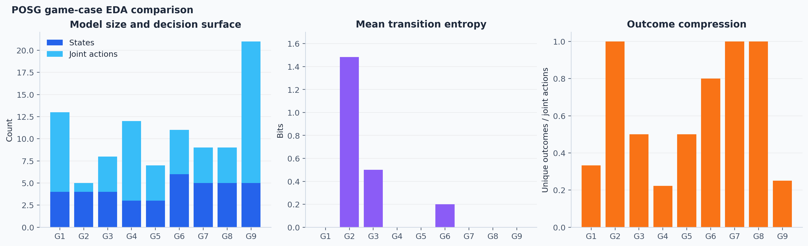
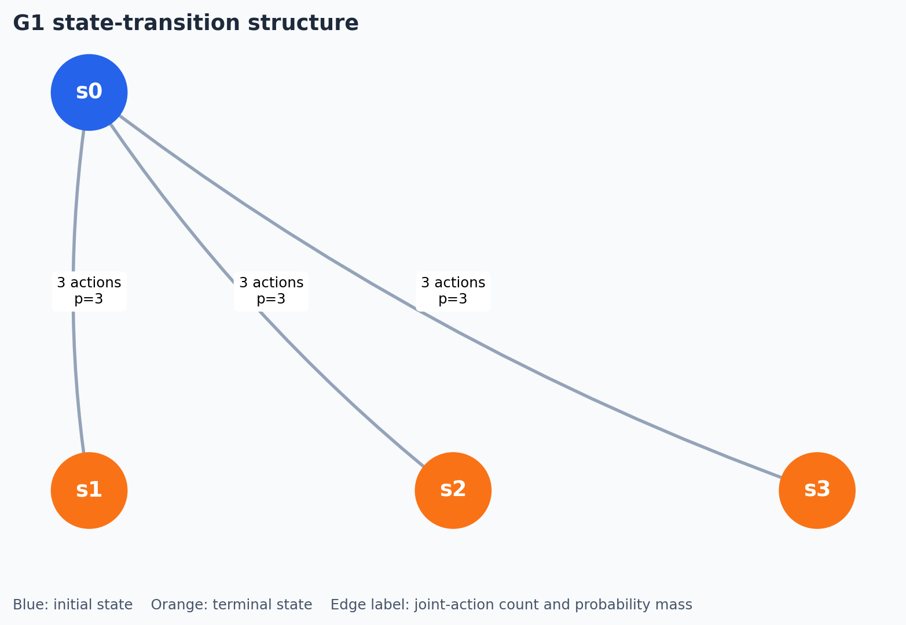
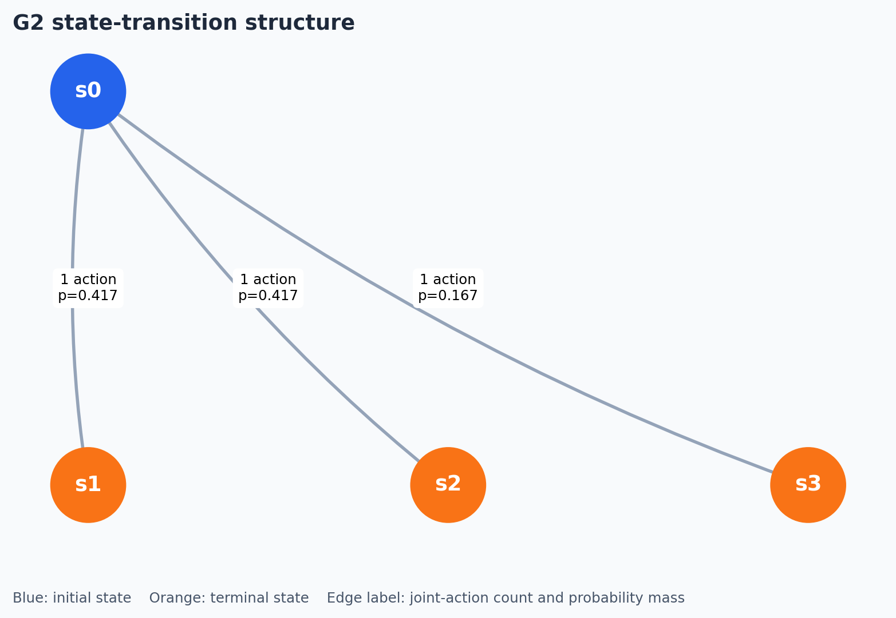
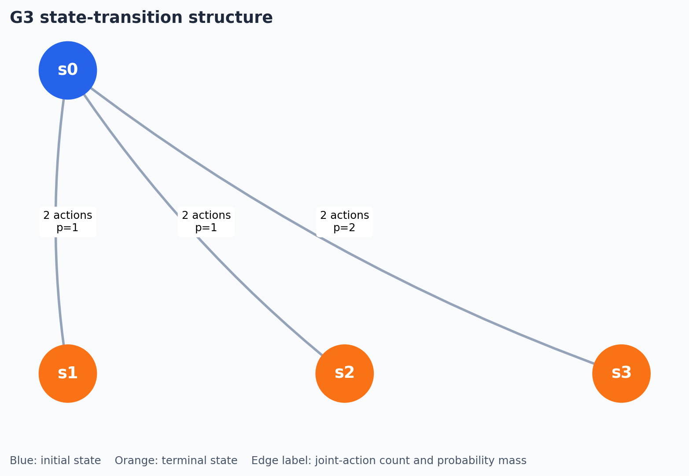
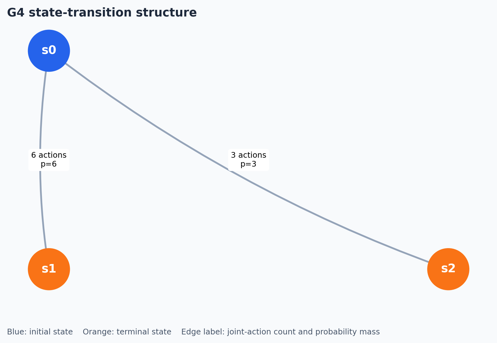
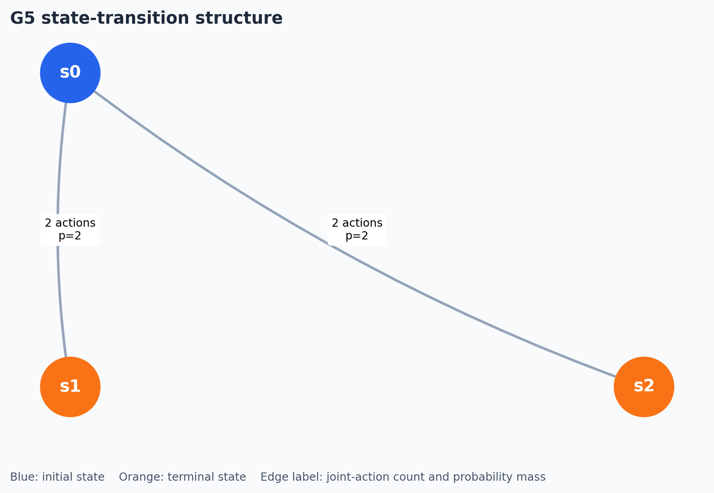
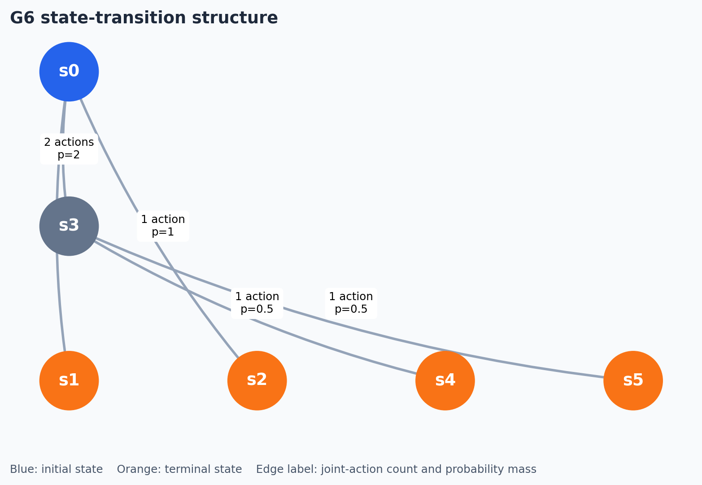
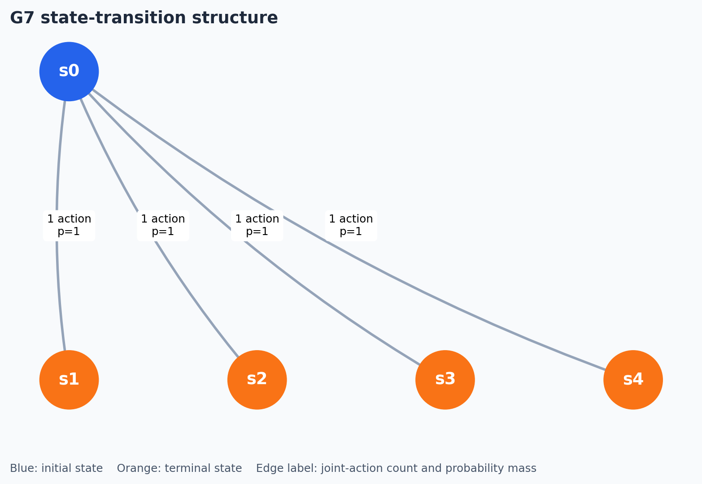
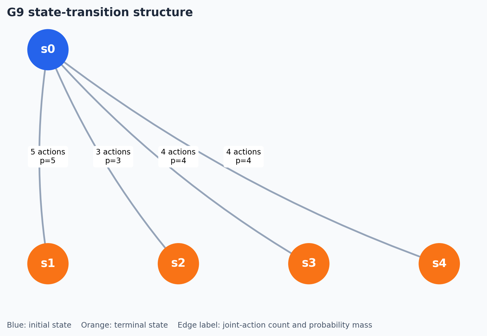

# Game POSG World-Model EDA

## Experiment

This report applies `WorldModelEDA` to the complete expected-output POSG schemas in the
current game benchmark. The repository currently contains **nine** game cases (G1-G9), not
ten. The analysis is descriptive: it enumerates the declared finite state/action/transition
structure and does not score whether the generated model is semantically correct.

Each case is loaded from its Markdown expected-output JSON. For every state reachable in the
declared schema, the experiment builds a directed state graph and a state-action-transition
graph, then calculates action branching, transition stochasticity and entropy, terminal
distance, and graph connectivity.

## Results

| Case | States | Terminal | Joint actions | Avg. branch | Stochastic | Avg. entropy (bits) | Max depth | SCCs | Avg. path |
| --- | ---: | ---: | ---: | ---: | ---: | ---: | ---: | ---: | ---: |
| G1 | 4 | 3 | 9 | 2.25 | 0% | 0.000 | 1 | 4 | 1.00 |
| G2 | 4 | 3 | 1 | 0.25 | 100% | 1.483 | 1 | 4 | 1.00 |
| G3 | 4 | 3 | 4 | 1.00 | 50% | 0.500 | 1 | 4 | 1.00 |
| G4 | 3 | 2 | 9 | 3.00 | 0% | 0.000 | 1 | 3 | 1.00 |
| G5 | 3 | 2 | 4 | 1.33 | 0% | 0.000 | 1 | 3 | 1.00 |
| G6 | 6 | 4 | 5 | 0.83 | 20% | 0.200 | 2 | 6 | 1.29 |
| G7 | 5 | 4 | 4 | 0.80 | 0% | 0.000 | 1 | 5 | 1.00 |
| G8 | 5 | 4 | 4 | 0.80 | 0% | 0.000 | 1 | 5 | 1.00 |
| G9 | 5 | 4 | 16 | 3.20 | 0% | 0.000 | 1 | 5 | 1.00 |



## Structural observations

- **One-step games dominate:** G1-G5 and G7-G9 transition directly from a single decision
  state to terminal outcomes. Their maximum terminal depth is one, and every state is its own
  strongly connected component, confirming that the schemas contain no cycles.
- **G6 is the only multi-step model:** equal bids route to a non-terminal tie-break state,
  then a stochastic Nature action selects a winner. It therefore has maximum terminal depth
  two and is the only case with a non-terminal transition after the initial joint action.
- **Stochasticity is localized:** G2 (dice duel) is stochastic at its only action; G3 is
  stochastic only for mismatched calls; and G6 is stochastic only at the tie-break. The
  remaining six cases are deterministic.
- **Outcome compression exposes action redundancy:** RPS (G1) maps nine joint actions to
  three outcomes, while Colonel Blotto (G9) maps sixteen allocations to four declared outcome
  classes. This is structural redundancy, not an error: distinct strategic choices can share
  an outcome state.
- **The report measures declared structure:** state labels collapse strategically distinct
  histories when the supplied schema uses a common outcome state. Use the state-action graph
  and reward metadata alongside this report for strategic interpretation.

## Graph artifacts

The files below use an initial-state/terminal-state color system and aggregate parallel
state transitions into edge labels showing joint-action count and probability mass. This keeps
the diagrams readable for sharing while preserving the full action-level representation in
the EDA object.

| Case | State-transition graph |
| --- | --- |
| G1 |  |
| G2 |  |
| G3 |  |
| G4 |  |
| G5 |  |
| G6 |  |
| G7 |  |
| G8 |  |
| G9 |  |

## Reproduction

```powershell
python report\generate_game_eda_report.py
python -m unittest tests.test_world_model_eda
```

`report\generate_game_eda_report.py` discovers G1-G9 from
`data\Test_Cases\03_game`, extracts each expected JSON object, regenerates the PNG figures,
and overwrites this report. The analysis implementation is in `world_model_eda\eda.py`.
